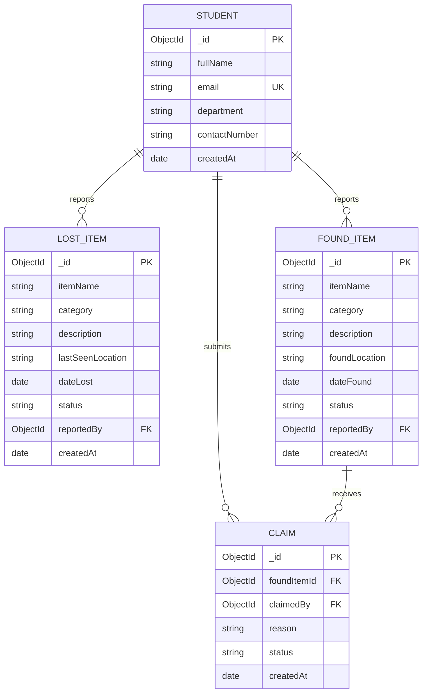

# Campus Lost & Found Management System

> **Full-Stack Development Assignment Project**  
> Built with **Node.js • Express.js • EJS • MongoDB • Mongoose**

---

## 1. Project Overview
The **Campus Lost & Found Management System** is a dynamic web application designed for college campuses. It replaces informal class messaging groups with a structured, verified database platform where students can:
1. Register authenticated **student profiles** with unique MongoDB IDs.
2. Report **lost items** with last-seen locations, incident dates, and categories.
3. Report **found items** discovered across campus.
4. Submit **ownership claims** explaining why an item belongs to them.
5. Empower item finders to **review, approve, or reject claims** under strict server-side authorization.
6. Automatically mark approved items as **Returned**, locking them from duplicate claims.

---

## 2. Project Directory Structure
The codebase strictly adheres to the requested architectural organization:

```text
campus-lost-found/
├── index.js                  # Main Express server, routing, and business logic
├── models/
│   ├── Student.js            # Student profile schema (Mongoose)
│   ├── LostItem.js           # Lost item schema with Student reference
│   ├── FoundItem.js          # Found item schema with Student reference
│   └── Claim.js              # Claim schema linking FoundItem and Student
├── views/
│   ├── partials/
│   │   ├── header.ejs        # Navigation bar, styling links, alerts
│   │   └── footer.ejs        # Footer and tech badges
│   ├── home.ejs              # Dashboard with metrics, recent reports & quick links
│   ├── lost-items.ejs        # Dynamic list of lost items with search & category filters
│   ├── lost-item-details.ejs # Detailed report of a lost item + finder contacts
│   ├── found-items.ejs       # Dynamic list of found items with status filters
│   ├── found-item-details.ejs# Found item details, claim form & finder review controls
│   ├── students.ejs          # Directory of registered students
│   ├── student-profile.ejs   # Dynamic student profile showing personal items & claims
│   ├── register-student.ejs  # Form to register a new student
│   ├── report-lost.ejs       # Form to report a lost item
│   ├── report-found.ejs      # Form to report a found item
│   ├── error.ejs             # Generalized friendly error page (400, 403, 500)
│   └── 404.ejs               # Custom 404 Not Found page
├── public/
│   └── styles.css            # Custom responsive CSS design system
├── .env                      # Environment configuration
├── package.json              # NPM dependencies and execution scripts
├── seed.js                   # Realistic database population script
├── test-scenarios.js         # Automated end-to-end test suite (21 test cases)
└── README.md                 # Complete documentation and setup manual
```

---

## 3. Database Design & Relational Model



### Model Relationships:
- **`Student`**: Holds individual records (`fullName`, `email`, `department`, `contactNumber`). Each student has an immutable, system-generated MongoDB `_id`. Names are never used as identifiers.
- **`LostItem`**: Stores lost belongings. The `reportedBy` field references a valid `Student._id`. Status can be `Lost`, `Found`, or `Closed`.
- **`FoundItem`**: Stores items picked up on campus. `reportedBy` references the student finder's `Student._id`. Status transitions between `Found` and `Returned`.
- **`Claim`**: Represents an ownership claim. Stores foreign keys `foundItemId` (ref: `FoundItem`) and `claimedBy` (ref: `Student`). Begins in `Pending` status and can become `Approved` or `Rejected`.

---

## 4. Environment Variables & Setup Instructions

### Prerequisites
- [Node.js](https://nodejs.org/) (v18+ recommended)
- [MongoDB](https://www.mongodb.com/) (running locally or MongoDB Atlas connection)

### Step 1: Clone / Navigate to Project
```bash
cd "C:\Campus Lost and Found Management"
```

### Step 2: Install Dependencies
```bash
npm install
```

### Step 3: Configure Environment Variables
Create or verify `.env` in the root directory:
```env
PORT=3000
MONGODB_URI=mongodb://127.0.0.1:27017/campus_lost_found
NODE_ENV=development
```

### Step 4: Seed Initial Data (Recommended)
Populate realistic campus students, lost items, found items, and demo claims:
```bash
npm run seed
```

### Step 5: Start the Server
```bash
npm start
```
Open your browser and visit:  
👉 **`http://localhost:3000`**

---

## 5. Required Routes Directory

| Method | Route | Description / Purpose |
|---|---|---|
| **GET** | `/` | Home dashboard with statistics, recent lost/found feeds, and quick actions |
| **GET** | `/students` | Directory listing of registered students |
| **GET** | `/register-student` | Form page to register a new student profile |
| **POST** | `/students` | Create a new student profile (validates email & uniqueness) |
| **GET** | `/students/:id` | Dynamic route: Display one student's profile, their reports, and claims |
| **GET** | `/lost-items` | Dynamic listing of all lost items with search & category filters |
| **GET** | `/report-lost` | Form page to report a lost item |
| **POST** | `/lost-items` | Submit a new lost-item report linked to a student |
| **GET** | `/lost-items/:id` | Dynamic route: View full details of a specific lost item |
| **GET** | `/found-items` | Dynamic listing of all found items with empty-state handling |
| **GET** | `/report-found` | Form page to report a found item |
| **POST** | `/found-items` | Submit a new found-item report linked to the finder |
| **GET** | `/found-items/:id` | Dynamic route: View found item details, claims list, and claim form |
| **POST** | `/found-items/:id/claims` | Submit an ownership claim for a found item |
| **PATCH** | `/claims/:id/status` | Approve or reject a claim (finder ownership enforced) |
| **PATCH** | `/found-items/:id/status`| Update found item status (e.g. to `Returned`) |

*Note: Both browser forms (via `_method=PATCH`) and direct REST API calls (`application/json`) are natively supported.*

---

## 6. Implementation of the 5 Required Thinking Challenges

### Challenge 1: Ownership Check (Finder-Only Approval)
- **Problem**: If Student A found an item, Student B must not be able to approve/reject a claim by tampering with the URL or request body.
- **Backend Enforcement**:
  In `PATCH /claims/:id/status`:
  ```javascript
  const foundItem = claim.foundItemId;
  if (foundItem.reportedBy.toString() !== reviewerStudentId.trim()) {
    return res.status(403).json({
      success: false,
      error: 'Forbidden: Only the student who reported finding this item can approve or reject claims.'
    });
  }
  ```
  If any other user attempts to approve or reject the claim, the server rejects it with **HTTP 403 Forbidden**.

### Challenge 2: Relationship Check (Referential Integrity)
- **Problem**: A claim must refer to an existing found item and an existing student. It must not be saved if either record is missing.
- **Backend Enforcement**:
  In `POST /found-items/:id/claims`:
  1. Checks `mongoose.Types.ObjectId.isValid` on both `foundItemId` and `claimedBy`.
  2. Executes `await FoundItem.findById(id)` and `await Student.findById(claimedBy)`.
  3. If either is missing, responds immediately with **HTTP 404 Not Found** without saving.

### Challenge 3: State Check (Returned Item Locking)
- **Problem**: Once an item is marked `Returned`, a new claim must be rejected.
- **Backend Enforcement**:
  In `POST /found-items/:id/claims`:
  ```javascript
  if (foundItem.status === 'Returned') {
    return res.status(400).json({
      success: false,
      error: 'This item has already been marked as Returned and cannot be claimed again.'
    });
  }
  ```
  Additionally, the EJS view (`found-item-details.ejs`) dynamically replaces the claim form with an informational banner confirming the item has been returned.

### Challenge 4: Duplicate-Claim Check
- **Problem**: Handle multiple claims from the same student for the same item.
- **Implementation & Justification**:
  A student can only have **one active (`Pending` or `Approved`) claim** per found item. If a previous claim was explicitly `Rejected`, they are allowed to submit a new one with corrected proof. However, submitting multiple concurrent pending claims is rejected with **HTTP 409 Conflict**:
  ```javascript
  const existingClaim = await Claim.findOne({
    foundItemId: foundItem._id,
    claimedBy: student._id,
    status: { $in: ['Pending', 'Approved'] },
  });
  if (existingClaim) {
    return res.status(409).json({ error: 'You already have an active claim on this item.' });
  }
  ```

### Challenge 5: Safe Update
- **Problem**: Updating a claim's status must not wipe or overwrite unrelated fields (such as reason, claimant reference, or timestamps).
- **Backend Enforcement**:
  The route loads the specific document, explicitly mutates only `claim.status = status;`, and calls `await claim.save()`. This preserves all existing fields and records an updated timestamp.

---

## 7. Testing & Verification

### Running Automated Test Suite
An automated test runner covering all 21 test scenarios is included:
```bash
npm test
```

### Verified Test Cases:
✔ **Successful Report Creation**: Student profiles, lost items, and found items created with relational references.  
✔ **Invalid MongoDB IDs**: Rejects malformed IDs (`not-a-valid-id`) with HTTP 400.  
✔ **Missing Records**: Handles queries for non-existent ObjectIds with HTTP 404 without crashing.  
✔ **Form Validation**: Rejects empty strings, whitespace-only fields, and invalid emails.  
✔ **Duplicate Email Rejection**: Rejects duplicate student emails with HTTP 400.  
✔ **Unauthorized Approval Attempt (Ownership Check)**: Non-finder attempting approval receives HTTP 403 Forbidden.  
✔ **Authorized Approval Workflow**: Genuine finder approves claim -> item marked `Returned` -> other pending claims closed.  
✔ **Claiming Returned Items**: New claims against a `Returned` item are rejected with HTTP 400.  
✔ **Duplicate Claims Prevention**: Second pending claim by the same student returns HTTP 409 Conflict.  
✔ **Self-Claim Prevention**: Finder cannot submit a claim for an item they found.  

---

## 8. Presentation Walkthrough: Complete Claim-to-Return Flow
During your demonstration, follow these quick steps:

1. **Step 1: Open the Application**
   - Navigate to `http://localhost:3000`. Show the statistics dashboard and dynamic recent feeds.
2. **Step 2: Check Student Profiles**
   - Visit `/students` to view registered students with their unique MongoDB ObjectIDs.
3. **Step 3: Report a Found Item**
   - Click **+ Report Found**. Select *Ananya Iyer* as the finder, enter an item (e.g. *"HP Wireless Mouse"*), and submit.
4. **Step 4: Submit a Claim**
   - Open the newly reported found item.
   - In the claim form, select claimant *Rohan Mehta* and enter a reason: *"Has a blue scratch on the bottom sensor and rechargeable battery inside"*. Submit the claim.
   - Note the claim now appears under the item with a yellow **Pending Review** badge.
5. **Step 5: Test Unauthorized Approval**
   - Attempt to approve the claim using an unauthorized student ID -> Server returns **403 Forbidden**.
6. **Step 6: Approve Claim as Finder**
   - Use the finder's review control to approve the claim.
   - The claim updates to a green **Approved** badge.
   - The found item status updates to green **Returned**.
   - Notice the claim submission box is now disabled and displays the return confirmation banner.
7. **Step 7: Verify Student Profiles**
   - Visit Rohan Mehta's profile (`/students/:id`). His approved claim is visible under his personal profile.
